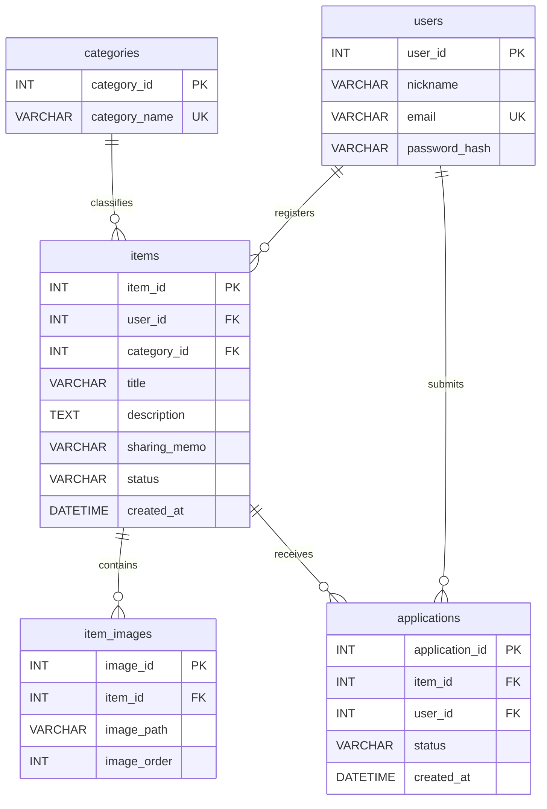

# 🥕 미림당근 (Mirim Carrot)

> 우리 학교 안에서 사용하지 않는 물건을 필요한 학생에게 무료로 나눌 수 있는 교내 나눔 웹사이트

**미림당근(Mirim Carrot)** 은 학교생활 중 사용하지 않게 된 교재, 학용품, 전자기기, 생활용품 등을 다른 학생에게 무료로 나눌 수 있도록 제작한 웹사이트입니다

학생들이 물품을 직접 등록하고, 필요한 물품에 나눔을 신청하며, 등록자가 신청자를 확인해 수락하거나 거절할 수 있도록 구현했습니다

Python의 Flask 프레임워크와 MySQL 관계형 데이터베이스를 사용하여 회원 관리, 물품 관리, 이미지 관리, 나눔 신청 관리 기능을 구현했습니다

---

## 📌 프로젝트 기본 정보

| 항목          | 내용                                                                  |
| ------------- | --------------------------------------------------------------------- |
| 프로젝트명    | 미림당근 (Mirim Carrot)                                               |
| 프로젝트 유형 | 데이터베이스 개인 프로젝트                                            |
| 개발 목적     | 교내 학생 간 무료 물품 나눔 서비스 제공                               |
| 개발 형태     | 웹 애플리케이션                                                       |
| 개발 언어     | Python, HTML, CSS, JavaScript                                         |
| 백엔드        | Flask                                                                 |
| 데이터베이스  | MySQL                                                                 |
| DB 이름       | mirim_carrot                                                          |
| 주요 기능     | 회원가입, 로그인, 물품 CRUD, 나눔 신청, 신청 수락 및 거절, 마이페이지 |
| 주요 사용자   | 학교 이메일을 사용하는 학생                                           |

---

# 📑 목차

1. 프로젝트 소개
2. 개발 배경 및 목적
3. 프로젝트 목표
4. 기술 스택
5. 시스템 아키텍처
6. 주요 기능
7. 사용자 이용 흐름
8. 프로젝트 폴더 구조
9. 데이터베이스 설계
10. ERD 및 테이블 관계
11. 데이터베이스 테이블 명세서
12. 데이터베이스 정규화
13. 주요 SQL 쿼리
14. Flask 라우팅 구조
15. 핵심 기능 구현 방식
16. 입력값 검증 및 보안
17. 프로젝트 실행 방법
18. 테스트 시나리오
19. 개발 과정 및 트러블슈팅
20. 프로젝트의 특징
21. 한계점 및 향후 개선 방향
22. 프로젝트를 통해 배운 점

---

# 1. 프로젝트 소개

## 1.1 미림당근이란?

미림당근은 학교 학생들이 사용하지 않는 물품을 다른 학생에게 무료로 나눌 수 있도록 제작한 교내 무료 나눔 플랫폼입니다.

일반적인 중고 거래 서비스와 달리 판매 가격이나 결제 기능을 제공하지 않고, 물품을 필요한 학생에게 전달하는 무료 나눔 방식에 집중했습니다.

사용자는 회원가입과 로그인 후 물품을 등록하거나 다른 학생이 등록한 물품에 나눔을 신청할 수 있습니다.

물품을 등록한 사용자는 신청자 목록을 확인하고 나눔 대상을 선택할 수 있습니다.

또한 마이페이지에서 자신이 등록한 물품과 신청한 물품을 확인할 수 있도록 구현했습니다.

## 1.2 주요 특징

### ① 교내 사용자 중심 서비스

회원가입 시 학교 이메일 도메인을 검사하여 학교 이메일을 사용하는 사용자를 대상으로 서비스를 제공합니다.

현재는 이메일 형식을 확인하는 방식이며, 이메일 인증 링크를 발송하는 기능은 구현되어 있지 않습니다.

### ② 무료 나눔 방식

물품 판매나 결제 기능 없이 무료 나눔에 집중했습니다.

이를 통해 학생들이 사용하지 않는 물품을 필요한 학생에게 전달할 수 있도록 했습니다.

### ③ 신청 기반 나눔

물품을 원하는 학생이 나눔을 신청하면 등록자가 신청자 목록을 확인할 수 있습니다.

등록자는 신청을 수락하거나 거절할 수 있으며, 신청을 수락하면 해당 물품의 상태가 자동으로 변경됩니다.

### ④ 물품 상태 관리

물품의 상태를 다음 두 가지로 구분했습니다.

- 나눔중
- 나눔완료

나눔이 완료된 물품은 추가 신청이나 수정 및 삭제를 제한하여 상태에 맞는 기능만 사용할 수 있도록 했습니다.

### ⑤ 이미지 등록 기능

물품을 등록할 때 사진을 첨부할 수 있습니다.

- 최대 5장
- JPG/JPEG 지원
- PNG 지원
- WEBP 지원
- 사진 1장당 최대 5MiB

이미지는 서버의 업로드 폴더에 저장하고, 이미지 경로는 데이터베이스에 저장합니다.

---

# 2. 개발 배경 및 목적

## 2.1 개발 배경

학교생활을 하다 보면 이전 학년에 사용했던 교재나 더 이상 사용하지 않는 학용품 등이 생깁니다.

이러한 물품은 여전히 사용할 수 있지만, 필요한 사람을 찾기 어려워 보관하거나 버리는 경우가 있습니다.

반대로 같은 물품이 필요한 학생은 새로 구매해야 하는 상황이 발생할 수 있습니다.

이러한 문제를 해결하기 위해 학교 학생들이 사용하지 않는 물품을 자유롭게 등록하고, 필요한 학생들이 쉽게 찾아 신청할 수 있는 웹사이트를 기획했습니다.

특히 학생들이 실제로 사용할 수 있는 서비스를 제작하면서 관계형 데이터베이스의 구조와 활용 방법을 직접 경험하고자 했습니다.

## 2.2 개발 목적

미림당근의 개발 목적은 다음과 같습니다.

1. 학교 학생 간 무료 나눔을 활성화합니다.
2. 사용하지 않는 물품의 재사용을 장려합니다.
3. 필요한 물품을 쉽게 찾을 수 있는 환경을 제공합니다.
4. 회원과 물품, 신청 정보를 체계적으로 관리합니다.
5. 관계형 데이터베이스를 실제 웹서비스에 적용합니다.
6. CRUD 기능을 직접 구현하여 데이터 처리 과정을 학습합니다.

---

# 3. 프로젝트 목표

## 3.1 기능적 목표

| 번호 | 목표           | 구현 내용                       |
| ---- | -------------- | ------------------------------- |
| 1    | 회원 관리      | 회원가입, 로그인, 로그아웃      |
| 2    | 물품 조회      | 전체 물품 목록 및 상세 조회     |
| 3    | 물품 등록      | 제목, 설명, 카테고리, 사진 등록 |
| 4    | 물품 수정      | 본인이 등록한 물품 수정         |
| 5    | 물품 삭제      | 본인이 등록한 물품 삭제         |
| 6    | 카테고리 관리  | 카테고리별 물품 필터링          |
| 7    | 나눔 신청      | 원하는 물품에 나눔 신청         |
| 8    | 신청 상태 관리 | 대기, 수락, 거절 상태 관리      |
| 9    | 나눔 완료 처리 | 신청 수락 시 물품 상태 변경     |
| 10   | 마이페이지     | 등록한 물품 및 신청한 물품 확인 |

## 3.2 데이터베이스 학습 목표

- 관계형 데이터베이스 설계
- 기본 키(PK)와 외래 키(FK) 이해
- 테이블 간 관계 설정
- 데이터베이스 정규화
- SELECT, INSERT, UPDATE, DELETE 활용
- INNER JOIN 활용
- 서브쿼리 활용
- 집계 함수 활용
- 트랜잭션 처리
- 데이터 무결성 유지

---

# 4. 기술 스택

## 4.1 Backend

| 기술                   | 설명                     | 사용 목적                |
| ---------------------- | ------------------------ | ------------------------ |
| Python                 | 프로그래밍 언어          | 서버 기능 구현           |
| Flask                  | Python 웹 프레임워크     | HTTP 요청 처리 및 라우팅 |
| mysql-connector-python | MySQL 연결 라이브러리    | Python과 MySQL 연결      |
| python-dotenv          | 환경변수 관리 라이브러리 | DB 접속 정보 관리        |
| Werkzeug               | Flask 관련 유틸리티      | 비밀번호 해시 및 검증    |

## 4.2 Frontend

| 기술       | 설명                | 사용 목적             |
| ---------- | ------------------- | --------------------- |
| HTML5      | 웹페이지 구조       | 화면 구성             |
| CSS3       | 스타일시트          | 디자인 및 레이아웃    |
| JavaScript | 클라이언트 스크립트 | 사용자 인터랙션       |
| Jinja2     | 템플릿 엔진         | 서버 데이터 화면 출력 |

## 4.3 Database

| 기술            | 사용 목적                     |
| --------------- | ----------------------------- |
| MySQL           | 관계형 데이터 저장 및 관리    |
| SQL             | 데이터 조회, 추가, 수정, 삭제 |
| MySQL Connector | Flask 서버와 DB 연결          |

## 4.4 개발 도구

| 도구               | 사용 목적                       |
| ------------------ | ------------------------------- |
| Visual Studio Code | 코드 작성 및 수정               |
| MySQL              | 데이터베이스 관리               |
| Git                | 버전 관리                       |
| GitHub             | 소스 코드 저장 및 프로젝트 공유 |
| Python venv        | 가상환경 관리                   |

---

# 5. 시스템 아키텍처

## 5.1 전체 시스템 구조

```text
┌───────────────────────────────┐
│          사용자 브라우저        │
│                               │
│    HTML / CSS / JavaScript    │
└──────────────┬────────────────┘
               │
               │ HTTP 요청
               │ GET / POST
               ▼
┌───────────────────────────────┐
│          Flask 서버           │
│                               │
│           app.py              │
│                               │
│  - 사용자 요청 처리            │
│  - 로그인 및 세션 관리          │
│  - 물품 등록 및 수정            │
│  - 나눔 신청 처리              │
│  - 데이터 유효성 검사           │
│  - 이미지 업로드 처리           │
└──────────────┬────────────────┘
               │
               │ SQL 실행
               ▼
┌───────────────────────────────┐
│        MySQL Database         │
│                               │
│         mirim_carrot          │
│                               │
│  - users                      │
│  - categories                 │
│  - items                      │
│  - item_images                │
│  - applications               │
└───────────────────────────────┘
```

## 5.2 데이터 처리 과정

사용자가 웹페이지에서 특정 기능을 실행하면 다음 순서로 처리됩니다.

1. 사용자가 HTML 화면에서 버튼을 클릭합니다.
2. 브라우저가 Flask 서버로 HTTP 요청을 전송합니다.
3. Flask가 요청한 URL에 해당하는 함수를 실행합니다.
4. 필요한 경우 사용자 로그인 상태와 입력값을 검사합니다.
5. MySQL에 SQL 쿼리를 실행합니다.
6. 데이터베이스가 처리 결과를 반환합니다.
7. Flask가 처리 결과에 따라 HTML을 렌더링하거나 다른 페이지로 이동시킵니다.

### 예시: 물품 등록

```text
사용자
  │
  ▼
나눔 등록 페이지
  │
  ▼
제목 / 카테고리 / 설명 / 사진 입력
  │
  ▼
등록 버튼 클릭
  │
  ▼
Flask 서버
  │
  ├── 로그인 여부 확인
  ├── 입력값 검사
  ├── 이미지 형식 검사
  ├── 이미지 용량 검사
  │
  ▼
MySQL
  │
  ├── items 테이블에 물품 저장
  └── item_images 테이블에 이미지 경로 저장
  │
  ▼
등록 완료
  │
  ▼
메인 페이지 이동
```

---

# 6. 주요 기능

## 6.1 회원가입

사용자가 닉네임, 학교 이메일, 비밀번호를 입력하여 계정을 생성하는 기능입니다.

### 입력 항목

| 항목          | 설명                    |
| ------------- | ----------------------- |
| 닉네임        | 서비스에서 사용할 이름  |
| 이메일        | 학교 이메일             |
| 비밀번호      | 로그인 비밀번호         |
| 비밀번호 확인 | 비밀번호 일치 여부 확인 |

### 검증 조건

- 모든 필수 항목 입력
- 학교 이메일 도메인 확인
- 비밀번호 8자 이상
- 비밀번호 확인값 일치
- 이메일 중복 가입 방지

비밀번호는 평문으로 저장하지 않고 해시값으로 변환하여 데이터베이스에 저장합니다.

## 6.2 로그인

회원가입한 사용자가 이메일과 비밀번호를 입력하여 로그인하는 기능입니다.

### 처리 과정

1. 이메일 입력
2. 비밀번호 입력
3. 데이터베이스에서 이메일 조회
4. 저장된 비밀번호 해시와 입력한 비밀번호 비교
5. 인증 성공 시 세션에 회원 정보 저장
6. 메인 페이지 이동

로그인에 성공하면 세션에 다음 정보를 저장합니다.

```python
session["user_id"] = user["user_id"]
session["nickname"] = user["nickname"]
```

## 6.3 로그아웃

로그아웃 시 세션에 저장된 로그인 정보를 초기화합니다.

```python
session.clear()
```

로그아웃 후에는 메인 페이지로 이동합니다.

## 6.4 메인 페이지

등록된 물품을 최신순으로 표시합니다.

### 표시 정보

- 물품 대표 이미지
- 물품 제목
- 등록자 닉네임
- 카테고리
- 물품 상태

물품 목록은 등록 날짜를 기준으로 내림차순 정렬합니다.

## 6.5 카테고리 필터

사용자가 원하는 종류의 물품만 조회할 수 있도록 카테고리 필터 기능을 구현했습니다.

### 카테고리 종류

| 카테고리  | 설명                       |
| --------- | -------------------------- |
| 도서      | 교재, 문제집, 일반 도서    |
| 전자기기  | 전자제품 및 주변기기       |
| 학용품    | 필기구, 노트 등            |
| 생활용품  | 일상생활에서 사용하는 물품 |
| 의류/잡화 | 의류 및 기타 잡화          |

사용자가 카테고리를 선택하면 해당 카테고리에 속하는 물품만 조회합니다.

## 6.6 물품 등록

로그인한 사용자가 새로운 나눔 물품을 등록하는 기능입니다.

### 입력 항목

| 항목      | 설명                     |
| --------- | ------------------------ |
| 제목      | 물품 이름                |
| 카테고리  | 물품 분류                |
| 설명      | 물품 상태 및 상세 내용   |
| 나눔 안내 | 전달 방법 등에 관한 메모 |
| 사진      | 물품 이미지              |

### 입력 제한

| 항목      | 제한                 |
| --------- | -------------------- |
| 제목      | 최대 100자           |
| 설명      | 최대 500자           |
| 나눔 안내 | 최대 255자           |
| 사진      | 최대 5장             |
| 사진 크기 | 장당 최대 5MiB       |
| 사진 형식 | JPG, JPEG, PNG, WEBP |

물품 등록 시 상태는 자동으로 `나눔중`으로 설정됩니다.

## 6.7 물품 상세 조회

물품을 선택하면 상세 정보를 확인할 수 있습니다.

### 조회 정보

- 물품 제목
- 물품 설명
- 카테고리
- 등록자
- 등록 날짜
- 물품 상태
- 나눔 안내
- 등록된 이미지

로그인한 사용자는 자신의 신청 상태를 확인할 수 있습니다.

물품 등록자는 신청자 목록을 추가로 확인할 수 있습니다.

## 6.8 물품 수정

본인이 등록한 물품의 정보를 수정할 수 있습니다.

### 수정 가능 항목

- 제목
- 카테고리
- 설명
- 나눔 안내
- 사진

### 수정 조건

- 로그인 상태
- 본인이 등록한 물품
- 물품 상태가 `나눔중`

새 사진을 등록하지 않으면 기존 사진을 유지합니다.

새 사진을 등록하면 기존 이미지 정보를 새로운 이미지 정보로 교체합니다.

## 6.9 물품 삭제

본인이 등록한 물품을 삭제하는 기능입니다.

### 삭제 조건

- 로그인 상태
- 본인이 등록한 물품
- 물품 상태가 `나눔중`

물품 삭제 시 관련된 신청 내역과 이미지 정보도 함께 삭제합니다.

데이터베이스 삭제가 완료되면 서버에 저장된 실제 이미지 파일도 삭제합니다.

## 6.10 나눔 신청

다른 학생이 등록한 물품에 나눔을 신청하는 기능입니다.

### 신청 조건

- 로그인 상태
- 본인이 등록하지 않은 물품
- 물품 상태가 `나눔중`
- 동일 물품에 대한 중복 신청이 없는 경우

신청이 완료되면 `applications` 테이블에 신청 내역이 추가됩니다.

최초 신청 상태는 `대기`입니다.

## 6.11 신청 수락

물품 등록자가 신청자를 선택하여 수락하는 기능입니다.

### 수락 처리 과정

1. 신청 내역 조회
2. 물품 등록자 확인
3. 물품 상태 확인
4. 신청 상태 확인
5. 선택한 신청을 `수락`으로 변경
6. 다른 대기 중인 신청을 `거절`로 변경
7. 물품 상태를 `나눔완료`로 변경

이 과정은 하나의 트랜잭션에서 처리하여 관련 데이터가 함께 변경되도록 했습니다.

## 6.12 신청 거절

물품 등록자가 특정 신청을 거절할 수 있습니다.

신청 상태를 `거절`로 변경하며, 물품 상태는 `나눔중`으로 유지됩니다.

## 6.13 신청 취소

신청자가 본인의 신청을 취소할 수 있습니다.

단, 신청 상태가 `대기`인 경우에만 취소할 수 있습니다.

신청 취소 시 해당 신청 내역을 데이터베이스에서 삭제합니다.

## 6.14 마이페이지

마이페이지는 두 개의 탭으로 구성됩니다.

### 내가 등록한 물품

- 등록한 물품 목록
- 물품 상태
- 대표 이미지
- 신청자 수

### 내가 신청한 물품

- 신청한 물품 목록
- 물품 등록자
- 신청 날짜
- 신청 상태
- 물품 상태

---

# 7. 사용자 이용 흐름

## 7.1 물품 등록자

```text
회원가입
   ↓
로그인
   ↓
나눔 등록
   ↓
물품 정보 입력
   ↓
물품 등록 완료
   ↓
신청자 확인
   ↓
신청 수락 / 거절
   ↓
나눔 완료
```

## 7.2 나눔 신청자

```text
회원가입
   ↓
로그인
   ↓
물품 목록 조회
   ↓
카테고리 선택
   ↓
물품 상세 조회
   ↓
나눔 신청
   ↓
신청 상태 확인
   ↓
수락 / 거절 결과 확인
```

---

# 8. 프로젝트 폴더 구조

아래는 주요 파일을 기준으로 정리한 프로젝트 구조입니다.

실제 CSS 및 JavaScript 파일명은 프로젝트 구성에 따라 다를 수 있습니다.

```text
mirim-carrot/
│
├── app.py
│
├── .env
├── .gitignore
├── README.md
│
├── templates/
│   ├── index.html
│   ├── login.html
│   ├── signup.html
│   ├── add.html
│   ├── detail.html
│   ├── edit.html
│   ├── mypage.html
│   └── notice.html
│
├── static/
│   ├── css/
│   │   └── ...
│   │
│   ├── js/
│   │   └── ...
│   │
│   ├── images/
│   │   └── ...
│   │
│   └── uploads/
│       └── ...
│
└── .venv/
```

## 8.1 주요 파일 설명

| 파일 또는 폴더  | 역할                           |
| --------------- | ------------------------------ |
| app.py          | Flask 서버의 주요 기능 구현    |
| templates/      | HTML 템플릿 저장               |
| static/css/     | CSS 파일 저장                  |
| static/js/      | JavaScript 파일 저장           |
| static/images/  | 기본 이미지 및 디자인 리소스   |
| static/uploads/ | 사용자가 등록한 물품 사진 저장 |
| .env            | 환경변수 및 DB 접속 정보       |
| .gitignore      | Git 추적 제외 파일 설정        |
| README.md       | 프로젝트 설명 문서             |
| .venv/          | Python 가상환경                |

---

# 9. 데이터베이스 설계

## 9.1 데이터베이스 개요

미림당근은 MySQL 관계형 데이터베이스를 사용합니다.

회원, 카테고리, 물품, 이미지, 신청 내역을 각각의 테이블로 분리하여 관리합니다.

### 데이터베이스 이름

```sql
mirim_carrot
```

### 사용 테이블

| 번호 | 테이블명     | 역할                  |
| ---- | ------------ | --------------------- |
| 1    | users        | 회원 정보 관리        |
| 2    | categories   | 물품 카테고리 관리    |
| 3    | items        | 물품 정보 관리        |
| 4    | item_images  | 물품 이미지 정보 관리 |
| 5    | applications | 나눔 신청 내역 관리   |

## 9.2 테이블 분리 이유

모든 정보를 하나의 테이블에 저장하면 회원 정보나 카테고리 정보가 여러 행에 반복될 수 있습니다.

예를 들어 한 회원이 물품을 10개 등록한다면 회원 닉네임과 이메일을 10번 저장해야 할 수 있습니다.

이러한 중복을 줄이기 위해 회원 정보는 `users` 테이블에 저장하고, 물품 정보에는 회원의 고유 번호인 `user_id`만 저장하도록 설계했습니다.

이미지와 신청 내역도 각각 별도의 테이블로 분리했습니다.

---

# 10. ERD 및 테이블 관계

## 10.1 ERD

아래 ERD는 Mermaid 문법으로 작성했습니다.

GitHub에서 지원되는 환경에서는 테이블 관계가 다이어그램으로 표시됩니다.



## 10.2 테이블 관계

| 부모 테이블 | 자식 테이블  | 관계 | 설명                        |
| ----------- | ------------ | ---- | --------------------------- |
| users       | items        | 1:N  | 회원 한 명이 여러 물품 등록 |
| users       | applications | 1:N  | 회원 한 명이 여러 나눔 신청 |
| categories  | items        | 1:N  | 카테고리 하나에 여러 물품   |
| items       | item_images  | 1:N  | 물품 하나에 여러 사진       |
| items       | applications | 1:N  | 물품 하나에 여러 신청       |

## 10.3 기본 키와 외래 키

### 기본 키(PK)

각 테이블의 데이터를 고유하게 구분하는 컬럼입니다.

예시:

```sql
user_id
item_id
application_id
```

### 외래 키(FK)

다른 테이블의 기본 키를 참조하는 컬럼입니다.

예시:

```sql
items.user_id
```

이 컬럼은 물품을 등록한 회원을 구분하기 위해 사용합니다.

```sql
applications.item_id
```

이 컬럼은 어떤 물품에 대한 신청인지 구분하기 위해 사용합니다.

---

# 11. 데이터베이스 테이블 명세서

> 아래 자료형은 프로젝트에서 사용하는 컬럼 구조를 바탕으로 정리한 설계 명세입니다. 실제 MySQL 테이블의 정확한 자료형과 NULL 설정은 `SHOW CREATE TABLE`로 확인해야 합니다.

## 11.1 users 테이블

### 테이블 설명

회원가입한 사용자의 정보를 저장하는 테이블입니다.

### 테이블명

`users`

| 컬럼명        | 자료형  | 키     | 설명                 |
| ------------- | ------- | ------ | -------------------- |
| user_id       | INT     | PK     | 회원 고유 번호       |
| nickname      | VARCHAR | -      | 사용자 닉네임        |
| email         | VARCHAR | UNIQUE | 로그인 이메일        |
| password_hash | VARCHAR | -      | 해시 처리된 비밀번호 |

### 주요 특징

- 회원을 구분하기 위한 기본 키 사용
- 이메일 중복 가입 방지
- 비밀번호 해시 저장
- 물품 및 신청 테이블과 연결

### 데이터 예시

| user_id | nickname | email                 |
| ------- | -------- | --------------------- |
| 1       | 당근이   | carrot1@e-mirim.hs.kr |
| 2       | 토끼     | rabbit2@e-mirim.hs.kr |
| 3       | 감자     | potato3@e-mirim.hs.kr |

※ 예시 데이터이며 실제 회원 정보가 아닙니다.

---

## 11.2 categories 테이블

### 테이블 설명

물품을 분류하기 위한 카테고리 정보를 저장합니다.

### 테이블명

`categories`

| 컬럼명        | 자료형  | 키     | 설명               |
| ------------- | ------- | ------ | ------------------ |
| category_id   | INT     | PK     | 카테고리 고유 번호 |
| category_name | VARCHAR | UNIQUE | 카테고리 이름      |

### 데이터 예시

| category_id | category_name |
| ----------- | ------------- |
| 1           | 도서          |
| 2           | 전자기기      |
| 3           | 학용품        |
| 4           | 생활용품      |
| 5           | 의류/잡화     |

### 테이블 분리 이유

카테고리 이름을 물품 테이블에 직접 반복해서 저장하는 대신, 카테고리 ID를 참조하도록 설계했습니다.

이를 통해 카테고리 정보를 일관되게 관리할 수 있습니다.

---

## 11.3 items 테이블

### 테이블 설명

사용자가 등록한 나눔 물품 정보를 저장합니다.

### 테이블명

`items`

| 컬럼명       | 자료형            | 키  | 설명           |
| ------------ | ----------------- | --- | -------------- |
| item_id      | INT               | PK  | 물품 고유 번호 |
| user_id      | INT               | FK  | 물품 등록자 ID |
| category_id  | INT               | FK  | 카테고리 ID    |
| title        | VARCHAR(100)      | -   | 물품 제목      |
| description  | TEXT              | -   | 물품 상세 설명 |
| sharing_memo | VARCHAR(255)      | -   | 나눔 안내      |
| status       | VARCHAR 또는 ENUM | -   | 나눔 상태      |
| created_at   | DATETIME          | -   | 등록 날짜      |

### 상태 값

```text
나눔중
나눔완료
```

### 데이터 예시

| item_id | user_id | category_id | title       | status   |
| ------- | ------- | ----------- | ----------- | -------- |
| 1       | 1       | 1           | 수학 문제집 | 나눔중   |
| 2       | 2       | 3           | 필통        | 나눔완료 |
| 3       | 1       | 2           | 키보드      | 나눔중   |

### 주요 특징

- 등록자와 외래 키로 연결
- 카테고리와 외래 키로 연결
- 물품별 상태 관리
- 등록 날짜 저장
- 신청 및 이미지 테이블과 연결

---

## 11.4 item_images 테이블

### 테이블 설명

물품에 첨부된 이미지 정보를 저장합니다.

### 테이블명

`item_images`

| 컬럼명      | 자료형  | 키  | 설명             |
| ----------- | ------- | --- | ---------------- |
| image_id    | INT     | PK  | 이미지 고유 번호 |
| item_id     | INT     | FK  | 연결된 물품 ID   |
| image_path  | VARCHAR | -   | 이미지 파일 경로 |
| image_order | INT     | -   | 이미지 표시 순서 |

### 데이터 예시

| image_id | item_id | image_path         | image_order |
| -------- | ------- | ------------------ | ----------- |
| 1        | 1       | uploads/photo1.jpg | 1           |
| 2        | 1       | uploads/photo2.jpg | 2           |
| 3        | 2       | uploads/photo3.png | 1           |

### 테이블 분리 이유

물품 하나에 여러 장의 사진을 등록할 수 있기 때문입니다.

이미지 경로를 `items` 테이블에 여러 컬럼으로 저장하면 사진 개수에 따라 컬럼이 증가하거나 빈 값이 발생할 수 있습니다.

따라서 이미지를 별도의 테이블로 관리하여 물품과 1:N 관계를 형성했습니다.

---

## 11.5 applications 테이블

### 테이블 설명

사용자의 나눔 신청 내역을 저장합니다.

### 테이블명

`applications`

| 컬럼명         | 자료형            | 키  | 설명           |
| -------------- | ----------------- | --- | -------------- |
| application_id | INT               | PK  | 신청 고유 번호 |
| item_id        | INT               | FK  | 신청한 물품 ID |
| user_id        | INT               | FK  | 신청한 회원 ID |
| status         | VARCHAR 또는 ENUM | -   | 신청 상태      |
| created_at     | DATETIME          | -   | 신청 날짜      |

### 신청 상태

```text
대기
수락
거절
```

### 데이터 예시

| application_id | item_id | user_id | status |
| -------------- | ------- | ------- | ------ |
| 1              | 1       | 2       | 대기   |
| 2              | 1       | 3       | 거절   |
| 3              | 2       | 1       | 수락   |

### 주요 특징

- 신청자와 물품 정보를 연결
- 신청 상태 관리
- 신청 날짜 저장
- 중복 신청 방지에 활용

동일한 사용자가 동일한 물품에 중복 신청하지 못하도록 다음 컬럼 조합에 UNIQUE 제약조건을 설정할 수 있습니다.

```sql
UNIQUE (item_id, user_id)
```

이 제약조건은 동일한 물품과 사용자 조합의 중복 저장을 방지합니다.

---

# 12. 데이터베이스 정규화

## 12.1 정규화란?

정규화는 관계형 데이터베이스에서 데이터 중복을 줄이고 데이터의 일관성을 유지하기 위해 테이블을 구조적으로 분리하는 과정입니다.

미림당근에서는 회원, 물품, 카테고리, 이미지, 신청 정보를 별도의 테이블로 관리하도록 설계했습니다.

## 12.2 제1정규형(1NF)

제1정규형은 각 컬럼에 하나의 원자적인 값이 저장되도록 하는 것입니다.

예를 들어 물품 이미지 여러 개를 하나의 컬럼에 쉼표로 구분해 저장하지 않고, `item_images` 테이블에 이미지별로 한 행씩 저장했습니다.

### 정규화 전 예시

| item_id | title  | images              |
| ------- | ------ | ------------------- |
| 1       | 문제집 | a.jpg, b.jpg, c.jpg |

### 정규화 후 예시

| image_id | item_id | image_path |
| -------- | ------- | ---------- |
| 1        | 1       | a.jpg      |
| 2        | 1       | b.jpg      |
| 3        | 1       | c.jpg      |

## 12.3 제2정규형(2NF)

제2정규형은 제1정규형을 만족하면서 기본 키의 일부에만 종속되는 일반 속성이 없도록 하는 것입니다.

미림당근의 주요 테이블은 각각 단일 컬럼 기본 키를 사용하므로, 복합 기본 키의 일부에만 종속되는 문제를 피할 수 있습니다.

## 12.4 제3정규형(3NF)

제3정규형은 제2정규형을 만족하면서 일반 속성 사이의 이행적 종속을 제거하는 것입니다.

예를 들어 물품 테이블에 등록자의 이메일과 닉네임을 반복해서 저장하지 않고, 회원 ID만 저장합니다.

회원 정보는 `users` 테이블에서 관리합니다.

카테고리 이름 역시 `categories` 테이블에서 관리하고, 물품 테이블에는 카테고리 ID를 저장합니다.

이를 통해 회원이나 카테고리 정보가 변경되더라도 여러 물품 데이터를 각각 수정할 필요가 없도록 설계했습니다.

※ 최종적인 정규형 판정은 실제 테이블 정의와 함수 종속성을 기준으로 확인해야 합니다.

---

# 13. 주요 SQL 쿼리

## 13.1 회원 정보 조회

로그인할 때 이메일에 해당하는 회원을 조회합니다.

```sql
SELECT *
FROM users
WHERE email = %s;
```

### 사용 목적

- 회원 존재 여부 확인
- 저장된 비밀번호 해시 조회
- 로그인 처리

---

## 13.2 회원가입

새로운 회원 정보를 저장합니다.

```sql
INSERT INTO users (
    nickname,
    email,
    password_hash
)
VALUES (%s, %s, %s);
```

### 사용 목적

- 회원 계정 생성
- 이메일과 닉네임 저장
- 해시 처리된 비밀번호 저장

---

## 13.3 전체 물품 조회

```sql
SELECT
    i.*,
    u.nickname,
    c.category_name
FROM items i
INNER JOIN users u
    ON i.user_id = u.user_id
INNER JOIN categories c
    ON i.category_id = c.category_id
ORDER BY i.created_at DESC;
```

### 사용 목적

- 물품 목록 출력
- 등록자 닉네임 표시
- 카테고리 이름 표시
- 최신순 정렬

### 사용된 SQL 문법

| 문법       | 설명             |
| ---------- | ---------------- |
| SELECT     | 데이터 조회      |
| INNER JOIN | 테이블 연결      |
| ON         | 테이블 연결 조건 |
| ORDER BY   | 정렬             |
| DESC       | 내림차순         |

---

## 13.4 카테고리별 물품 조회

```sql
SELECT
    i.item_id,
    i.title,
    i.description,
    c.category_name
FROM items i
INNER JOIN categories c
    ON i.category_id = c.category_id
WHERE c.category_name = %s
ORDER BY i.created_at DESC;
```

### 사용 목적

사용자가 선택한 카테고리에 해당하는 물품만 조회합니다.

---

## 13.5 물품 등록

```sql
INSERT INTO items (
    user_id,
    category_id,
    title,
    description,
    sharing_memo,
    status
)
VALUES (
    %s,
    %s,
    %s,
    %s,
    %s,
    '나눔중'
);
```

### 사용 목적

사용자가 작성한 물품 정보를 데이터베이스에 저장합니다.

최초 등록 상태는 `나눔중`입니다.

---

## 13.6 이미지 정보 등록

```sql
INSERT INTO item_images (
    item_id,
    image_path,
    image_order
)
VALUES (%s, %s, %s);
```

### 사용 목적

물품에 등록된 이미지의 경로와 표시 순서를 저장합니다.

실제 이미지 파일은 서버의 `static/uploads` 폴더에 저장합니다.

---

## 13.7 물품 상세 조회

```sql
SELECT
    i.*,
    u.nickname,
    c.category_name
FROM items i
INNER JOIN users u
    ON i.user_id = u.user_id
INNER JOIN categories c
    ON i.category_id = c.category_id
WHERE i.item_id = %s;
```

### 사용 목적

특정 물품의 상세 정보와 등록자, 카테고리를 조회합니다.

---

## 13.8 나눔 신청

```sql
INSERT INTO applications (
    item_id,
    user_id,
    status
)
VALUES (
    %s,
    %s,
    '대기'
);
```

### 사용 목적

사용자가 선택한 물품에 대한 나눔 신청 내역을 저장합니다.

---

## 13.9 신청자 목록 조회

```sql
SELECT
    a.application_id,
    a.status,
    a.created_at,
    u.nickname
FROM applications a
INNER JOIN users u
    ON a.user_id = u.user_id
WHERE a.item_id = %s
ORDER BY a.created_at DESC;
```

### 사용 목적

물품 등록자가 해당 물품의 신청자 목록을 확인할 때 사용합니다.

---

## 13.10 신청 수락

```sql
UPDATE applications
SET status = '수락'
WHERE application_id = %s;
```

### 사용 목적

선택한 신청자의 상태를 수락으로 변경합니다.

---

## 13.11 다른 신청 거절

```sql
UPDATE applications
SET status = '거절'
WHERE item_id = %s
AND status = '대기';
```

### 사용 목적

한 신청이 수락되면 해당 물품의 다른 대기 신청을 거절 처리합니다.

---

## 13.12 물품 상태 변경

```sql
UPDATE items
SET status = '나눔완료'
WHERE item_id = %s;
```

### 사용 목적

나눔 신청이 수락된 물품을 나눔 완료 상태로 변경합니다.

---

## 13.13 물품 수정

```sql
UPDATE items
SET
    title = %s,
    category_id = %s,
    description = %s,
    sharing_memo = %s
WHERE item_id = %s;
```

### 사용 목적

등록자가 기존 물품의 정보를 수정합니다.

---

## 13.14 나눔 신청 취소

```sql
DELETE FROM applications
WHERE application_id = %s
AND user_id = %s
AND status = '대기';
```

### 사용 목적

본인이 신청한 대기 상태의 신청을 취소합니다.

---

## 13.15 물품 삭제

```sql
DELETE FROM applications
WHERE item_id = %s;

DELETE FROM item_images
WHERE item_id = %s;

DELETE FROM items
WHERE item_id = %s;
```

### 사용 목적

물품 삭제 시 관련된 신청 및 이미지 데이터를 먼저 삭제한 후 물품 데이터를 삭제합니다.

외래 키 제약조건을 고려한 삭제 순서입니다.

---

## 13.16 신청자 수 조회

```sql
SELECT COUNT(*)
FROM applications
WHERE item_id = %s;
```

### 사용 목적

특정 물품에 신청한 사용자의 수를 계산합니다.

`COUNT(*)`는 조건에 해당하는 행의 개수를 반환합니다.

---

# 14. Flask 라우팅 구조

Flask에서는 `@app.route()`를 사용하여 URL과 Python 함수를 연결합니다.

## 14.1 전체 라우팅 목록

| URL                        | HTTP 메서드 | 함수               | 기능        |
| -------------------------- | ----------- | ------------------ | ----------- |
| `/`                        | GET         | home               | 메인 페이지 |
| `/signup`                  | GET, POST   | signup             | 회원가입    |
| `/login`                   | GET, POST   | login              | 로그인      |
| `/logout`                  | POST        | logout             | 로그아웃    |
| `/add`                     | GET, POST   | add                | 물품 등록   |
| `/item/<item_id>`          | GET         | item_detail        | 물품 상세   |
| `/apply/<item_id>`         | POST        | apply              | 나눔 신청   |
| `/accept/<application_id>` | POST        | accept_application | 신청 수락   |
| `/reject/<application_id>` | POST        | reject_application | 신청 거절   |
| `/mypage`                  | GET         | mypage             | 마이페이지  |
| `/cancel/<application_id>` | POST        | cancel_application | 신청 취소   |
| `/edit/<item_id>`          | GET, POST   | edit_item          | 물품 수정   |
| `/delete/<item_id>`        | POST        | delete_item        | 물품 삭제   |
| `/notice`                  | GET         | notice             | 공지사항    |

## 14.2 GET과 POST의 차이

### GET

주로 페이지를 조회하거나 데이터를 요청할 때 사용합니다.

예시:

```python
@app.route("/")
def home():
    return render_template("index.html")
```

### POST

주로 데이터를 제출하거나 변경할 때 사용합니다.

예시:

```python
@app.route("/logout", methods=["POST"])
def logout():
    session.clear()
    return redirect(url_for("home"))
```

---

# 15. 핵심 기능 구현 방식

## 15.1 데이터베이스 연결 함수

```python
def db():
    return mysql.connector.connect(
        host=os.getenv("DB_HOST"),
        port=int(os.getenv("DB_PORT", "3306")),
        user=os.getenv("DB_USER"),
        password=os.getenv("DB_PASSWORD"),
        database=os.getenv("DB_NAME")
    )
```

### 설명

MySQL 연결에 필요한 정보를 환경변수에서 가져와 데이터베이스 연결 객체를 생성합니다.

데이터베이스 연결 코드를 함수로 분리하여 다른 기능에서 재사용할 수 있도록 했습니다.

## 15.2 데이터 조회 함수

```python
def read(sql, params=(), one=False):
    conn = db()

    try:
        with conn.cursor(dictionary=True) as cur:
            cur.execute(sql, params)
            return cur.fetchone() if one else cur.fetchall()
    finally:
        conn.close()
```

### 설명

SQL SELECT 쿼리를 실행하고 조회 결과를 반환합니다.

- `fetchone()` : 한 행 조회
- `fetchall()` : 여러 행 조회
- `dictionary=True` : 조회 결과를 딕셔너리 형태로 반환

## 15.3 로그인 여부 확인

```python
def logged_in():
    return "user_id" in session
```

### 설명

현재 세션에 사용자 ID가 저장되어 있는지 확인합니다.

로그인 여부에 따라 특정 기능의 접근을 제한합니다.

## 15.4 비밀번호 해시

```python
generate_password_hash(password)
```

사용자가 입력한 비밀번호를 해시값으로 변환합니다.

```python
check_password_hash(saved_hash, password)
```

로그인할 때 저장된 해시와 입력한 비밀번호가 일치하는지 확인합니다.

## 15.5 이미지 파일명 생성

```python
name = uuid.uuid4().hex + "." + ext
```

### 설명

UUID를 이용하여 고유한 파일명을 생성합니다.

서로 다른 사용자가 동일한 파일명의 이미지를 등록하더라도 파일명이 충돌할 가능성을 줄일 수 있습니다.

## 15.6 트랜잭션 처리

```python
conn.commit()
```

데이터베이스 변경 내용을 확정합니다.

```python
conn.rollback()
```

오류가 발생하면 확정되지 않은 변경 내용을 취소합니다.

물품 등록, 수정, 삭제, 신청 수락 등 여러 데이터가 함께 변경되는 작업에서 사용합니다.

## 15.7 행 잠금

```sql
SELECT user_id, status
FROM items
WHERE item_id = %s
FOR UPDATE;
```

### 설명

트랜잭션이 진행되는 동안 조회한 행에 잠금을 설정합니다.

동시에 여러 요청이 발생했을 때 같은 물품의 상태가 충돌하는 문제를 줄이기 위해 사용합니다.

---

# 16. 입력값 검증 및 보안

## 16.1 비밀번호 보호

비밀번호를 그대로 저장하지 않고 해시 처리하여 저장합니다.

이를 통해 데이터베이스에 저장된 비밀번호 원문이 직접 노출되는 것을 방지합니다.

## 16.2 로그인 세션

Flask 세션을 이용하여 로그인 상태를 유지합니다.

로그인하지 않은 사용자가 물품 등록이나 신청 기능에 접근하면 로그인 페이지로 이동시킵니다.

## 16.3 접근 권한 검사

물품 수정 및 삭제 시 현재 로그인한 사용자가 해당 물품의 등록자인지 확인합니다.

```python
if item["user_id"] != session["user_id"]:
    return "권한이 없습니다.", 403
```

이를 통해 다른 사용자의 물품을 임의로 수정하거나 삭제하지 못하도록 제한합니다.

## 16.4 SQL 파라미터 바인딩

SQL 실행 시 사용자 입력값을 문자열에 직접 연결하지 않고 파라미터로 전달합니다.

```python
cur.execute(
    "SELECT * FROM users WHERE email=%s",
    (email,)
)
```

이를 통해 SQL 인젝션 공격 위험을 줄입니다.

## 16.5 이미지 검증

업로드한 이미지의 다음 항목을 검사합니다.

- 파일 개수
- 파일 확장자
- 파일 크기
- 파일 데이터의 기본 시그니처

파일 확장자만 확인하는 것이 아니라 파일 데이터의 시작 부분도 확인합니다.

다만 이미지 파일 전체의 무결성까지 완전히 검증하는 방식은 아닙니다.

## 16.6 환경변수 관리

데이터베이스 비밀번호와 Flask 비밀키를 `.env` 파일에 저장합니다.

민감한 정보를 소스 코드에 직접 작성하지 않도록 했습니다.

`.env` 파일은 GitHub에 업로드하지 않도록 주의해야 합니다.

---

# 17. 프로젝트 실행 방법

## 17.1 실행 환경

- Python 3
- MySQL
- Visual Studio Code 또는 Python 실행 환경
- 필요한 Python 라이브러리

## 17.2 프로젝트 다운로드

GitHub에서 프로젝트를 내려받거나 프로젝트 폴더를 준비합니다.

## 17.3 가상환경 생성

프로젝트 폴더에서 터미널을 실행합니다.

```bash
python -m venv .venv
```

## 17.4 가상환경 활성화

Windows PowerShell:

```powershell
.\.venv\Scripts\Activate.ps1
```

Windows CMD:

```cmd
.venv\Scripts\activate.bat
```

## 17.5 라이브러리 설치

```bash
pip install flask mysql-connector-python python-dotenv
```

## 17.6 환경변수 설정

프로젝트 루트에 `.env` 파일을 생성합니다.

```env
DB_HOST=localhost
DB_PORT=3306
DB_USER=root
DB_PASSWORD=YOUR_PASSWORD
DB_NAME=mirim_carrot
SECRET_KEY=YOUR_SECRET_KEY
```

### 환경변수 설명

| 변수        | 설명                            |
| ----------- | ------------------------------- |
| DB_HOST     | 데이터베이스 서버 주소          |
| DB_PORT     | MySQL 포트 번호                 |
| DB_USER     | MySQL 사용자 계정               |
| DB_PASSWORD | MySQL 비밀번호                  |
| DB_NAME     | 사용할 데이터베이스             |
| SECRET_KEY  | Flask 세션 서명에 사용할 비밀키 |

실제 비밀번호와 비밀키는 공개 저장소에 업로드하지 않아야 합니다.

## 17.7 데이터베이스 준비

MySQL에서 데이터베이스를 생성합니다.

```sql
CREATE DATABASE IF NOT EXISTS mirim_carrot
CHARACTER SET utf8mb4
COLLATE utf8mb4_unicode_ci;
```

```sql
USE mirim_carrot;
```

프로젝트에 필요한 테이블과 카테고리 초기 데이터를 생성해야 합니다.

정확한 테이블 생성 SQL은 실제 MySQL 스키마에 맞게 준비해야 합니다.

## 17.8 Flask 서버 실행

```bash
python app.py
```

정상적으로 실행되면 터미널에 개발 서버 주소가 표시됩니다.

일반적인 기본 주소는 다음과 같습니다.

```text
http://127.0.0.1:5000
```

브라우저에서 해당 주소로 접속합니다.

---

# 18. 테스트 시나리오

다음은 주요 기능을 확인하기 위한 테스트 체크리스트입니다.

실제 테스트 수행 여부와 결과는 별도로 기록해야 합니다.

## 18.1 회원 기능

| 번호 | 테스트 항목                  | 예상 결과        |
| ---- | ---------------------------- | ---------------- |
| 1    | 정상 회원가입                | 회원 정보 저장   |
| 2    | 학교 이메일이 아닌 주소 입력 | 가입 제한        |
| 3    | 중복 이메일 가입             | 오류 메시지      |
| 4    | 비밀번호 확인 불일치         | 가입 제한        |
| 5    | 정상 로그인                  | 메인 페이지 이동 |
| 6    | 잘못된 비밀번호 입력         | 로그인 실패      |
| 7    | 로그아웃                     | 세션 초기화      |

## 18.2 물품 기능

| 번호 | 테스트 항목               | 예상 결과 |
| ---- | ------------------------- | --------- |
| 8    | 정상 물품 등록            | 물품 저장 |
| 9    | 제목 미입력               | 등록 제한 |
| 10   | 카테고리 미선택           | 등록 제한 |
| 11   | 이미지 6장 업로드         | 등록 제한 |
| 12   | 지원하지 않는 파일 업로드 | 등록 제한 |
| 13   | 물품 상세 조회            | 정보 표시 |
| 14   | 본인 물품 수정            | 정보 변경 |
| 15   | 타인 물품 수정            | 접근 거부 |
| 16   | 본인 물품 삭제            | 물품 삭제 |
| 17   | 타인 물품 삭제            | 접근 거부 |

## 18.3 나눔 신청 기능

| 번호 | 테스트 항목            | 예상 결과      |
| ---- | ---------------------- | -------------- |
| 18   | 정상 나눔 신청         | 대기 상태 저장 |
| 19   | 본인 물품 신청         | 신청 제한      |
| 20   | 중복 신청              | 오류 메시지    |
| 21   | 대기 신청 취소         | 신청 내역 삭제 |
| 22   | 신청 수락              | 수락 상태 변경 |
| 23   | 신청 거절              | 거절 상태 변경 |
| 24   | 신청 수락 후 물품 확인 | 나눔완료 표시  |
| 25   | 완료 물품 추가 신청    | 신청 제한      |

---

# 19. 개발 과정 및 트러블슈팅

## 19.1 MySQL 연결 오류

### 문제 상황

Flask 서버에서 MySQL에 연결하는 과정에서 오류가 발생했습니다.

### 원인

MySQL 서버 실행 상태, 연결 설정 또는 Python 라이브러리 설치 상태가 원인일 수 있었습니다.

### 해결 방법

- MySQL 서버 실행 여부 확인
- 데이터베이스 이름 확인
- 사용자 계정 및 비밀번호 확인
- MySQL Connector 설치
- 환경변수 설정 확인

### 학습 내용

웹 애플리케이션과 데이터베이스를 연결하기 위해서는 서버 실행 상태와 접속 정보가 정확해야 한다는 점을 학습했습니다.

---

## 19.2 Python 라이브러리 오류

### 문제 상황

프로그램 실행 중 다음과 같은 오류가 발생했습니다.

```text
ModuleNotFoundError: No module named 'mysql'
```

```text
ModuleNotFoundError: No module named 'dotenv'
```

```text
ModuleNotFoundError: No module named 'flask'
```

### 원인

현재 Python 실행 환경에 필요한 라이브러리가 설치되어 있지 않았습니다.

### 해결 방법

```bash
pip install mysql-connector-python
pip install python-dotenv
pip install flask
```

가상환경이 활성화되어 있는지도 함께 확인했습니다.

### 학습 내용

Python 프로젝트에서는 라이브러리 설치 여부뿐 아니라 현재 실행 중인 Python 환경도 중요하다는 점을 알게 되었습니다.

---

## 19.3 이미지 경로 문제

### 문제 상황

물품 이미지를 등록했지만 웹페이지에서 이미지가 정상적으로 표시되지 않는 문제가 발생했습니다.

### 원인

이미지 파일의 실제 저장 위치와 HTML에서 사용하는 이미지 경로가 일치하지 않았습니다.

### 해결 방법

Flask의 `static` 폴더 구조를 확인하고, 이미지 경로를 올바르게 연결하도록 수정했습니다.

### 학습 내용

서버의 파일 저장 경로와 브라우저에서 접근하는 URL 경로는 구분해야 한다는 점을 이해했습니다.

---

## 19.4 GitHub Push 오류

### 문제 상황

GitHub에 코드를 업로드하는 과정에서 원격 저장소와 로컬 저장소의 변경 이력이 달라 Push가 거부되는 문제가 발생했습니다.

### 해결 방법

원격 저장소의 변경 사항을 먼저 반영한 후 다시 Push했습니다.

```bash
git pull --rebase origin main
```

```bash
git push origin main
```

※ 브랜치 이름은 실제 사용 중인 브랜치에 맞게 변경해야 합니다.

### 학습 내용

Git은 단순히 파일을 업로드하는 도구가 아니라 변경 이력을 관리하는 버전 관리 시스템이라는 점을 이해했습니다.

---

## 19.5 중복 코드 관리

### 문제 상황

상품 등록과 수정 기능에서 이미지 검사, 입력값 검사, 이미지 저장 코드가 반복되었습니다.

### 해결 방법

반복되는 기능을 공통 함수로 분리했습니다.

대표적인 공통 함수는 다음과 같습니다.

```python
item_input()
```

```python
save_images()
```

```python
remove_images()
```

### 개선 효과

- 코드 중복 감소
- 유지보수 편의성 향상
- 동일한 검증 기준 재사용
- 코드 구조 이해 용이

---

# 20. 프로젝트의 특징

## 20.1 실제 학교생활과 연결된 서비스

학교에서 사용하지 않는 물품을 나누는 상황을 바탕으로 기획했습니다.

단순한 데이터 입력 프로그램이 아니라 학생들이 실제로 이용할 수 있는 웹서비스 형태로 구현했습니다.

## 20.2 관계형 데이터베이스 활용

회원, 카테고리, 물품, 이미지, 신청 내역을 별도의 테이블로 관리했습니다.

테이블 간 관계를 활용하여 여러 데이터를 연결하고 필요한 정보를 조회했습니다.

## 20.3 CRUD 기능 구현

물품 관리에 필요한 네 가지 기본 기능을 구현했습니다.

| 기능   | SQL    | 구현 내용 |
| ------ | ------ | --------- |
| Create | INSERT | 물품 등록 |
| Read   | SELECT | 물품 조회 |
| Update | UPDATE | 물품 수정 |
| Delete | DELETE | 물품 삭제 |

## 20.4 신청 상태에 따른 데이터 변경

신청 상태와 물품 상태를 구분하여 관리했습니다.

특정 신청을 수락하면 신청 상태뿐 아니라 물품 상태와 다른 신청자의 상태도 함께 변경하도록 구현했습니다.

## 20.5 권한에 따른 기능 제한

사용자가 본인의 물품만 수정하거나 삭제할 수 있도록 했습니다.

물품 등록자만 신청을 수락하거나 거절할 수 있도록 제한했습니다.

---

# 21. 한계점 및 향후 개선 방향

## 21.1 학교 이메일 인증

현재는 학교 이메일 도메인을 확인하는 방식으로 회원가입을 제한하고 있습니다.

향후에는 이메일 인증 코드를 발송하여 실제 이메일 소유 여부를 확인하는 기능을 추가할 수 있습니다.

## 21.2 물품 검색 기능

현재 구현된 물품 조회 및 카테고리 필터 기능을 확장하여 제목이나 설명을 기준으로 검색할 수 있도록 개선할 수 있습니다.

## 21.3 나눔 알림 기능

신청 수락이나 거절 결과를 사용자가 더 빠르게 확인할 수 있도록 알림 기능을 추가할 수 있습니다.

## 21.4 이미지 관리 개선

이미지 파일의 저장 방식과 검증 기능을 개선하여 보다 안정적인 파일 업로드 환경을 구성할 수 있습니다.

## 21.5 관리자 기능

향후 관리자 계정을 도입하여 부적절한 물품이나 회원을 관리하는 기능을 추가할 수 있습니다.

## 21.6 실제 서비스 배포

현재 개발 환경에서 실행하는 Flask 서버를 실제 배포 환경에 맞게 구성할 수 있습니다.

배포 시에는 다음 사항을 고려해야 합니다.

- 디버그 모드 비활성화
- HTTPS 적용
- 안전한 비밀키 관리
- 데이터베이스 접근 권한 제한
- 파일 업로드 보안 강화
- 오류 및 로그 관리
- 데이터 백업

---

# 22. 프로젝트를 통해 배운 점

이번 프로젝트를 통해 데이터베이스가 단순히 데이터를 저장하는 공간이 아니라 웹서비스의 여러 기능을 연결하는 중요한 요소라는 점을 알게 되었습니다.

처음에는 회원, 물품, 신청 정보를 각각 어떻게 저장하고 연결해야 할지 고민이 많았습니다.

특히 하나의 물품에 여러 장의 사진이 등록되고, 여러 명의 사용자가 같은 물품에 신청할 수 있다는 점을 고려하여 테이블 간 관계를 설계하는 과정이 중요했습니다.

이 과정에서 기본 키와 외래 키의 역할을 이해하고, 데이터 중복을 줄이기 위해 테이블을 분리하는 방법을 학습했습니다.

또한 Python과 Flask를 이용하여 MySQL에 직접 연결하고, SQL을 실행하여 웹페이지의 데이터를 조회하거나 변경하는 과정을 경험했습니다.

물품 등록, 수정, 삭제와 같은 CRUD 기능뿐 아니라 신청 수락 시 여러 테이블의 데이터를 함께 변경하는 트랜잭션 처리도 구현해 볼 수 있었습니다.

개발 과정에서는 라이브러리 설치 문제, 데이터베이스 연결 오류, 이미지 경로 문제 등 다양한 오류가 발생했습니다.

이러한 문제를 직접 확인하고 해결하면서 프로그램의 오류 원인을 분석하는 능력도 기를 수 있었습니다.

이번 프로젝트는 데이터베이스 설계부터 백엔드 개발, 프론트엔드 화면 연결까지 하나의 웹서비스를 직접 구현해 본 경험이라는 점에서 의미가 있었습니다.

---

# 🥕 마무리

미림당근은 학교 학생들이 사용하지 않는 물품을 필요한 학생에게 무료로 나눌 수 있도록 제작한 웹사이트입니다.

Python Flask와 MySQL을 활용하여 회원 관리, 물품 CRUD, 이미지 관리, 나눔 신청 및 상태 관리 기능을 구현했습니다.

특히 관계형 데이터베이스의 테이블 관계, 외래 키, JOIN, 트랜잭션을 실제 서비스 기능에 적용했다는 점에서 의미가 있는 프로젝트입니다.

앞으로도 사용자 편의성과 안정성을 개선하여 학생들이 더욱 편리하게 이용할 수 있는 서비스로 발전시키고자 합니다.

---

**Mirim Carrot — 필요한 물건은 나누고, 새로운 가치는 함께 만들어요. 🥕**
